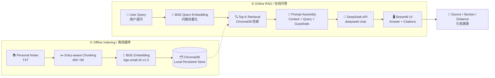
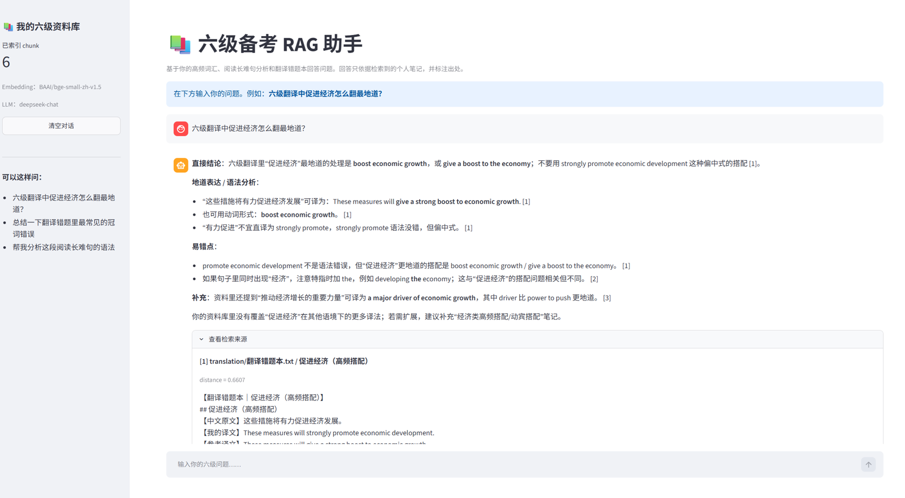

<div align="center">

# CET6-RAG Atlas

**A Vertical-Domain Retrieval-Augmented Generation Assistant for CET-6 Preparation**

**面向大学英语六级备考的垂直领域 RAG 智能问答系统**

[](https://www.python.org/)
[](https://streamlit.io/)
[](https://www.langchain.com/)
[](https://www.trychroma.com/)
[](https://huggingface.co/BAAI/bge-small-zh-v1.5)
[](https://www.deepseek.com/)
[](LICENSE)

**English** · [概述](#overview) · [架构](#architecture) · [快速开始](#quick-start) · [踩坑记录](#pitfalls)

</div>

---

<a id="overview"></a>
## 📖 Overview | 项目简介

**CET6-RAG Atlas** is a vertical-domain RAG assistant built for one specific job: turning a learner's own CET-6 notes into a grounded, citation-backed question-answering system.

It is **not another ChatGPT wrapper**. Every answer is generated from retrieved personal notes — vocabulary entries, long-sentence analyses, and translation-error records — and every claim is traceable to a source chunk.

**CET6-RAG Atlas** 是一个面向大学英语六级备考的垂直领域 RAG 问答系统。它把个人整理的高频词汇、阅读长难句分析和翻译错题本转化为可检索的本地知识库，让大模型在**个人笔记的约束下**回答问题，并给出可展开查看的引用来源。

> **Design principle / 设计原则**
>
> Retrieval first, generation second. If the notes do not contain the answer, the system should say so — not invent one.
>
> 先检索，后生成。资料里没有依据时，系统应该明确说“资料不足”，而不是编造。

### Why "Atlas"? | 为什么叫 Atlas

An atlas is not a pile of maps; it is a **structured, navigable map of a territory**. CET6-RAG Atlas treats a learner's notes as a knowledge territory: chunks are mapped into a vector space, retrieved by meaning, and assembled into a grounded answer.

Atlas 不是地图的堆叠，而是对一片知识疆域的**结构化索引**。这个项目把个人笔记切分成可检索的知识单元，映射到向量空间，再按语义召回并组装成有依据的回答。

---

## ✨ Core Features | 核心特性

### 1. Citation-Grounded Generation | 引用溯源防幻觉

Every answer is generated from a bounded context of top-K retrieved chunks. The model is instructed to cite `[1]`, `[2]`, `[3]`, and the UI exposes the exact source file, section, and vector distance behind each citation.

- **English:** No free-floating model knowledge. If the retrieved context is insufficient, the assistant explicitly says so.
- **中文：** 回答只允许使用检索到的个人笔记；资料不足时明确说明，避免“看起来很对”的幻觉答案。
- **Traceability / 可追溯：** `source` + `section` + `chunk_id` + `distance` 全部保留，点击“查看检索来源”即可核对原文。

### 2. Structured Prompt & Structured Output | 结构化 Prompt 与输出

The prompt is assembled as a three-part contract:

```text
[System Role]      CET-6 tutor; answer only from retrieved context
[Retrieved Context] [1] source / section / content
[User Question]    the learner's question
```

The expected answer shape is also structured:

```text
1. Direct conclusion / 直接结论
2. Idiomatic expression or grammar analysis / 地道表达或语法分析
3. Common pitfalls / 易错点
4. Citations / 引用编号
```

This makes the output predictable for learners and easier to evaluate than a free-form chat response.

### 3. Local-First, Lightweight Deployment | 本地化轻量级部署

- **Local knowledge:** notes, chunks, and ChromaDB vectors stay on disk.
- **Retrieval fallback:** if the ChromaDB file is unavailable or corrupted, the app automatically switches to a NumPy-based local index (`data/local_index`), so the UI remains usable.
- **Lightweight embedding:** `BAAI/bge-small-zh-v1.5` runs through **FastEmbed + ONNX Runtime**, so there is **no PyTorch dependency and no GPU requirement**.
- **Minimal network surface:** only the retrieved context and question are sent to the DeepSeek API at generation time.
- **One-command UI:** `streamlit run app.py`, or double-click a Windows `.bat` script.

**中文：** 笔记、切分结果和向量库全部保存在本地；BGE 使用 ONNX 推理，不装 PyTorch、不要求 GPU；只有生成回答时，检索到的片段和问题会发送给 DeepSeek。

### 4. Vertical-Domain by Design | 垂直领域设计

| Corpus / 资料 | Purpose / 用途 | Metadata |
|---|---|---|
| 高频词汇 / Vocabulary | 词义、搭配、例句 | `doc_type=vocabulary` |
| 阅读长难句 / Long Sentences | 主干、修饰成分、语法分析 | `doc_type=long_sentences` |
| 翻译错题本 / Translation Errors | 原文、试译、参考译文、错因 | `doc_type=translation` |

The system is deliberately narrow: it is a CET-6 study assistant, not a general-purpose chatbot. Narrowness is a feature — it makes retrieval, prompting, and evaluation tractable.

### 5. Entry-Aware Chunking | 条目感知切分

Instead of blindly splitting by character count, the pipeline first splits notes into **self-contained entries** using a `---` delimiter, then recursively splits only entries that exceed the chunk budget.

- Preserves “原文 / 我的译文 / 参考译文 / 错因” as one semantic unit.
- Default: `chunk_size=400`, `chunk_overlap=80`, tuned for BGE's 512-token input window.
- Adds `source`, `doc_type`, `section`, `chunk_id`, and `char_count` metadata for filtering and citation.

---

<a id="architecture"></a>
## 🏗 System Architecture | 系统架构



**Online path / 在线链路：**

```text
用户提问
  → BGE 向量化
  → ChromaDB Top-K 检索
  → 组装 Prompt（资料 + 问题 + 约束）
  → DeepSeek 生成
  → Streamlit 展示回答与引用
```

**Offline path / 离线链路：**

```text
个人笔记 txt
  → 按条目切分
  → chunks.jsonl
  → BGE Embedding
  → ChromaDB 持久化
```

> A high-resolution SVG version is available at [`docs/architecture.svg`](docs/architecture.svg).

---

## 🧰 Tech Stack | 技术栈

| Layer / 层 | Technology / 技术 | Why / 选型理由 |
|---|---|---|
| Language | Python 3.12 | Stable AI ecosystem on Windows |
| Frontend | Streamlit 1.66 | Fast chat UI, minimal boilerplate |
| Orchestration | LangChain Core + Text Splitters | Document abstraction and recursive chunking |
| Embedding | `BAAI/bge-small-zh-v1.5` (512-dim) | Strong Chinese retrieval at small size |
| Embedding Runtime | FastEmbed + ONNX Runtime | No PyTorch, CPU-friendly |
| Vector Store | ChromaDB 1.5 | Local persistence, simple Python API |
| LLM | DeepSeek `deepseek-chat` | Strong Chinese generation, OpenAI-compatible API |
| HTTP Client | `requests` | Direct control over Chat Completions requests |

**Design goal:** run end-to-end on a normal Windows laptop, without a GPU and without a heavyweight deep-learning stack.

---

## 📸 Demo | 效果展示



**Example / 示例：**

| Item | Value |
|---|---|
| Query | 六级翻译中促进经济怎么翻最地道？ |
| Top-1 source | `translation/翻译错题本.txt` → `促进经济（高频搭配）` |
| Distance | `0.6607` |
| Answer | `boost economic growth` / `give a boost to the economy` |
| Citations | `[1]`, `[2]`, `[3]` with expandable source cards |

---

<a id="quick-start"></a>
## 🚀 Quick Start | 快速开始

### Prerequisites | 环境要求

- Windows 10 / 11 (macOS / Linux also work with equivalent commands)
- Python **3.12**
- A DeepSeek API key with available balance
- No GPU required

### 1. Clone & create environment | 克隆并创建虚拟环境

```bash
git clone https://github.com/<your-name>/cet6-rag-atlas.git
cd cet6-rag-atlas

py -3.12 -m venv .venv
```

Activate the environment:

```powershell
# Windows PowerShell
.\.venv\Scripts\Activate.ps1

# If script execution is blocked, use the interpreter directly:
# .\.venv\Scripts\python.exe <command>
```

### 2. Install dependencies with a mirror | 使用镜像安装依赖

```powershell
.\.venv\Scripts\python.exe -m pip install -i https://pypi.tuna.tsinghua.edu.cn/simple -r requirements.txt
```

If pip's new resolver hangs on Windows, use the legacy resolver:

```powershell
.\.venv\Scripts\python.exe -m pip install --use-deprecated=legacy-resolver -i https://pypi.tuna.tsinghua.edu.cn/simple -r requirements.txt
```

> **Note:** Do not upgrade pip inside the install script. On some Windows setups, `pip install -U pip` can hang for minutes.
>
> **注意：** 不要在安装脚本里顺手升级 pip；部分 Windows 环境下 `pip install -U pip` 会长时间卡住。

### 3. Configure the API key | 配置 API Key

```powershell
Copy-Item .env.example .env
```

Edit `.env`:

```text
DEEPSEEK_API_KEY=sk-your-key-here
```

`.env` is ignored by Git and must never be committed.

### 4. Build the knowledge base | 构建知识库

```powershell
.\.venv\Scripts\python.exe step1_chunk.py
.\.venv\Scripts\python.exe step2_build_index.py
```

The first run downloads the BGE model (~95 MB). For users in mainland China:

```powershell
$env:HF_ENDPOINT = "https://hf-mirror.com"
```

### 5. Launch Streamlit | 启动前端

```powershell
.\.venv\Scripts\python.exe -m streamlit run app.py
```

Open:

```text
http://localhost:8501
```

> If ChromaDB cannot open its database file, the app automatically falls back to the NumPy index in `data/local_index/`. Rebuild it with `python local_index.py` if needed.
>
> 如果 ChromaDB 数据库文件损坏，页面会自动切换到 `data/local_index/` 的 NumPy 索引；需要手动重建时运行 `python local_index.py`。

### 6. Optional: CLI mode | 可选：命令行模式

```powershell
.\.venv\Scripts\python.exe step3_ask.py
```

Then ask:

```text
六级翻译中促进经济怎么翻最地道？
```

Type `exit` to quit.

### Windows one-click scripts | Windows 一键脚本

| Script | Purpose |
|---|---|
| `一键运行.bat` | Build chunks from `data/raw` |
| `一键运行_第二步.bat` | Embed chunks and build ChromaDB |
| `一键运行_第三步.bat` | CLI RAG question answering |
| `一键运行_第四步.bat` | Launch the Streamlit UI |

---

## 📂 Data Format | 数据格式

Place notes under:

> The repository ships with a small CET-6 demo corpus: **6 translation-error entries**, **46 past translation prompts**, **69 translation phrases**, **50 high-frequency words** and **15 long-sentence analyses**. Replace them with your own notes for real use. If your notes contain private information, add `data/raw/` to `.gitignore` before committing.
>
> 仓库自带一套六级示例资料：**6 条翻译错题、46 篇历年翻译真题、69 条翻译高频短语、50 个高频词、15 个长难句分析**，保证 clone 后可以立即跑通。正式使用时请替换为自己的笔记；如果笔记包含隐私，提交前把 `data/raw/` 加入 `.gitignore`。

```text
data/raw/
├─ vocabulary/          # 高频词汇
├─ long_sentences/      # 阅读长难句
└─ translation/         # 翻译错题
```

Each entry starts with `##` and is separated by a single `---` line:

```text
## 促进经济
【中文原文】这些措施将有力促进经济发展。
【我的译文】These measures will strongly promote economic development.
【参考译文】These measures will give a strong boost to economic growth.
【错因】“促进经济”更地道的搭配是 boost economic growth。
---
## 减少污染
【中文原文】政府正在采取措施减少空气污染。
【参考译文】The government is taking measures to reduce air pollution.
【错因】pollution 是泛指，不需要加 the。
```

**Guidelines / 整理建议：**

- One entry = one self-contained knowledge point.
- Keep entries under ~400 Chinese characters when possible.
- Use a topic title, not “错题 1” / “句子 2”.
- Keep Chinese grammar analysis in long-sentence entries; it materially improves Chinese-query recall.
- Do not split question and answer into separate files.

---

## 🧠 Engineering Details | 核心实现

### 1. Chunking strategy | 切分策略

| Parameter | Value | Rationale |
|---|---|---|
| Entry delimiter | `---` | Preserves self-contained Q&A / word / sentence units |
| `chunk_size` | `400` chars | Fits BGE's 512-token window with header margin |
| `chunk_overlap` | `80` chars | Preserves boundary context |
| Splitter | `RecursiveCharacterTextSplitter` | Prefers paragraphs → sentences → characters |

Each output chunk carries:

```json
{
  "source": "translation/翻译错题本.txt",
  "doc_type": "translation",
  "section": "促进经济",
  "chunk_id": "chk_xxx",
  "char_count": 319
}
```

### 2. Retrieval configuration | 检索配置

| Setting | Value |
|---|---|
| Top-K | `3` |
| Distance | ChromaDB default (L2 on normalized embeddings) |
| Embedding dim | `512` |
| Collection | `cet6_notes` |
| Storage | `data/chroma_db/` |

### 3. Prompt contract | Prompt 约束

```text
SYSTEM:
You are a CET-6 tutor. Answer only from the retrieved context.
If the context is insufficient, say so explicitly. Do not invent facts.
Cite sources as [1], [2], [3].

USER:
[Retrieved Context]
[1] source / section
...

[Question]
...

Produce:
1. Direct conclusion
2. Idiomatic expression or grammar analysis
3. Common pitfalls
4. Citations
```

### 4. Why FastEmbed instead of Sentence-Transformers? | 为什么用 FastEmbed

`sentence-transformers` pulls in PyTorch, which can exceed 2 GB on Windows and adds significant install friction. FastEmbed runs the same BGE model through ONNX Runtime, keeps the install lightweight, and is sufficient for a single-user local RAG application.

**中文：** `sentence-transformers` 会引入 PyTorch，Windows 下安装体积大、失败率高；FastEmbed 使用 ONNX Runtime 加载同一个 BGE 模型，体积小、CPU 可跑，非常适合个人本地项目。

---

<a id="pitfalls"></a>
## 🧑‍💻 Developer Pitfalls | 开发者踩坑记录

### 1. ChromaDB on Windows: path escaping / 路径转义问题

**Symptom / 现象：**

```text
chromadb.errors.InternalError:
error returned from database: (code: 14) unable to open database file
```

**Root cause / 原因：**

On Windows, `PersistentClient(path=...)` may treat the final path segment as a database file when the path does not end with a separator. The SQLite file can end up in the parent directory, and subsequent runs fail with `code: 14`.

在 Windows 下，如果传给 `PersistentClient` 的路径末尾没有分隔符，ChromaDB 可能把最后一级目录当成数据库文件名，导致 SQLite 文件落到父目录，进而报 `unable to open database file`。

**Bad / 错误写法：**

```python
client = chromadb.PersistentClient(path=str(DB_DIR))
```

**Good / 正确写法：**

```python
import os

client = chromadb.PersistentClient(path=str(DB_DIR) + os.sep)
```

**Additional fix / 补充修复：**

Do not delete and recreate the entire database directory on every run. On Windows, an open file handle can block directory removal. Keep the directory and rebuild only the collection:

```python
client = chromadb.PersistentClient(path=str(DB_DIR) + os.sep)

try:
    client.delete_collection(COLLECTION_NAME)
except Exception:
    pass

collection = client.create_collection(COLLECTION_NAME)
```

**中文：** 不要每次运行都 `shutil.rmtree(chroma_db)`。Windows 文件句柄未释放时，删目录会失败；保留目录、只重建 collection 更稳。

### 2. pip resolver hangs on Windows | pip 解析器卡住

**Symptom:** installation stalls after `Requirement already satisfied: pip`, sometimes for minutes, with high CPU.

**Fix:**

```powershell
python -m pip install --use-deprecated=legacy-resolver -r requirements.txt
```

Also avoid `pip install -U pip` inside automation scripts.

### 3. Mirror URL typo | 镜像地址拼写错误

A missing `/` turns:

```text
https://pypi.tuna.tsinghua.edu.cn/simple
```

into:

```text
https://pypi.tuna.tsinghua.edu.cn-simple
```

The second one is a different hostname and will fail with `getaddrinfo failed`.

### 4. HuggingFace model download is slow | 模型下载慢

```powershell
$env:HF_ENDPOINT = "https://hf-mirror.com"
```

The model is cached under `models/`, so this is a one-time cost.

### 5. Streamlit first-run prompt | Streamlit 首次运行提示

The project includes `.streamlit/config.toml` with `headless = true` to avoid the first-run email prompt. The Windows launcher opens the browser explicitly after the server starts.

---

## 📁 Project Structure | 目录结构

```text
cet6-rag-atlas/
├─ app.py                     # Streamlit UI
├─ step1_chunk.py             # TXT → chunks.jsonl
├─ step2_build_index.py       # BGE → ChromaDB
├─ step3_ask.py               # CLI RAG pipeline
├─ local_index.py             # NumPy fallback index
├─ requirements.txt
├─ .env.example
├─ .streamlit/
│  └─ config.toml
├─ data/
│  ├─ raw/                    # your notes (vocabulary / long sentences / translation)
│  ├─ chunks/chunks.jsonl     # generated
│  ├─ chroma_db/              # generated vector store
│  └─ local_index/            # generated fallback index
├─ models/                    # BGE cache (generated)
├─ docs/
│  ├─ architecture.svg
│  └─ demo-answer.png
├─ 一键运行*.bat              # Windows launchers
├─ LICENSE
└─ README.md
```

---

## 🗺 Roadmap | 路线图

- [x] Entry-aware chunking with metadata
- [x] BGE + ChromaDB local vector store
- [x] DeepSeek grounded generation with citations
- [x] Streamlit chat UI with expandable sources
- [ ] Hybrid retrieval (BM25 + dense vectors)
- [ ] Cross-encoder reranking (`bge-reranker`)
- [ ] Retrieval evaluation set (Recall@K, citation hit rate)
- [ ] Incremental indexing for edited notes
- [ ] Conversation memory with context compression
- [ ] Dockerized deployment

---

## ⚠️ Limitations | 当前限制

- The bundled demo index is intentionally small: 6 translation-error entries, 46 past translation prompts, 69 translation phrases, 50 words and 15 long-sentence analyses. It is not a substitute for a complete CET-6 corpus.
- Retrieval is dense-only; no BM25 or reranker yet.
- Designed for single-user local use; no authentication or multi-tenant isolation.
- Generation quality depends on the coverage and structure of the personal notes.

**中文：** 当前示例库包含 6 条翻译错题、46 篇历年翻译真题、69 条翻译短语、50 个高频词和 15 个长难句，规模仍然有限；项目定位是个人本地学习工具，不是多用户生产系统。

---

## 🤝 Contributing | 参与贡献

Issues and pull requests are welcome. If you are adding a new corpus or retrieval feature, please include:

1. A minimal reproducible example.
2. The expected retrieval result before/after the change.
3. Any new dependency with a short justification.

For major changes, open an issue first to discuss the design.

---

## 📄 License | 许可证

Code is released under the [MIT License](LICENSE).

Personal notes, API keys, generated vector databases, and model caches are **not** part of the open-source code and should not be committed.

---

## 🙏 Acknowledgements | 致谢

- [LangChain](https://www.langchain.com/) for document abstractions and text splitters
- [ChromaDB](https://www.trychroma.com/) for the local vector store
- [BAAI](https://huggingface.co/BAAI) for `bge-small-zh-v1.5`
- [FastEmbed](https://github.com/qdrant/fastembed) for lightweight ONNX embeddings
- [DeepSeek](https://www.deepseek.com/) for the generation API
- [Streamlit](https://streamlit.io/) for the UI layer

---

<div align="center">

**Built for focused CET-6 preparation — retrieve your own notes, cite your own evidence.**

**为专注的六级备考而建：检索自己的笔记，引用自己的依据。**

If this project helps you, consider giving it a ⭐.

</div>
